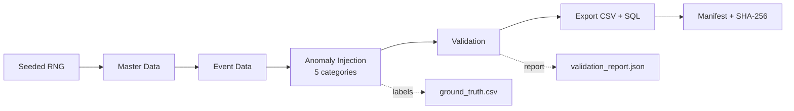

# SafeOps Generator


A deterministic synthetic data engine simulating 30 days of industrial alarm, operator-workflow, and safety-incident data for testing and validating safety monitoring systems.

## Table of Contents

- [Project Purpose](#project-purpose)
- [Business Context](#business-context)
- [Visual Workflow](#visual-workflow)
- [Prerequisites](#prerequisites)
- [Installation](#installation)
- [Usage](#usage)
- [Use Cases](#use-cases)
- [Generation Pipeline](#generation-pipeline)
- [Data Schema](#data-schema)
- [Anomaly Categories](#anomaly-categories)
- [Incident Traceability](#incident-traceability)
- [Ground Truth](#ground-truth)
- [Validation](#validation)
- [Reproducibility](#reproducibility)
- [Output Files](#output-files)
- [Sample Output](#sample-output)
- [Evaluating a Detector](#evaluating-a-detector)
- [Known Assumptions and Limitations](#known-assumptions-and-limitations)
- [Testing](#testing)
- [Configuration](#configuration)
- [Project Structure](#project-structure)
- [License](#license)
- [Contact](#contact)

## Project Purpose

The SafeOps Generator produces realistic, relationally consistent synthetic industrial factory operations data with explicitly injected and labeled safety anomalies. It is designed for testing safety monitoring, anomaly detection, and data validation systems in industrial operational technology (OT) environments.

## Business Context

Industrial factories generate complex time-series data from machines, safety systems, and operator workflows. Testing safety monitoring systems requires realistic datasets that include:
- Normal operational baselines
- Safety anomaly scenarios
- Relational consistency across entities
- Deterministic reproducibility for test comparisons

This generator provides such datasets with:
- Master/reference data (plants, machines, safety zones, interlocks, alarm definitions)
- Time-series event data (shifts, state changes, alarms, acknowledgements, incidents, corrective actions)
- Five labeled anomaly categories
- Ground-truth documentation for validation

## Visual Workflow



## Prerequisites

- Python 3.11 or higher
- pandas 2.2.3
- numpy 2.1.3
- pytest 8.3.3 (for testing)

## Installation

1. Clone the repository:
```bash
git clone https://github.com/PodishettiRakesh/industrial-safeops-generator.git
cd industrial-safeops-generator
```

2. Install dependencies:
```bash
pip install -r requirements.txt
```

## Usage

### DEV Profile (Fast Testing)

Generate a small dataset for development and testing:
```bash
python -m safeops.generator --profile dev --output-dir output_dev
```

**DEV Profile Specs:**
- 2 plants
- 5 machines
- 10 alarm definitions
- 500 alarm events
- ~400 acknowledgements
- ~250-1000 machine state events
- ~50-100 incidents
- ~100-300 corrective actions

### FULL Profile (Large-Scale Testing)

Generate a large-scale dataset:
```bash
python -m safeops.generator --profile full --output-dir output_full
```

**FULL Profile Specs:**
- 4 plants
- 60 machines
- 200 alarm definitions
- 50,000 alarm events
- ~40,000 acknowledgements
- ~3,000-12,000 machine state events
- ~50-100 incidents
- ~100-300 corrective actions

### CLI Options

```bash
python -m safeops.generator --profile {dev|full} [OPTIONS]

Options:
  --profile {dev,full}   Generation profile (required)
  --output-dir PATH      Output directory (default: output)
  --seed INT             Random seed for reproducibility (default: 20261022)
  --verify-reproducibility  Run reproducibility verification
```

### Reproducibility Verification

Verify that identical seeds produce identical outputs:
```bash
python -m safeops.generator --profile full --verify-reproducibility
```

This generates the dataset twice in temporary directories and compares all files byte-for-byte.

## Use Cases

- Testing anomaly detectors with labeled ground truth
- Validating SIEM/monitoring rule logic
- Benchmarking data processing pipelines
- Creating reproducible test fixtures for CI/CD

## Generation Pipeline

The generator follows this pipeline:

1. **Initialize RNG** - Seeded deterministic random number generation
2. **Generate Master Data** - Plants, machines, safety zones, interlocks, alarm definitions
3. **Generate Event Data** - Operator shifts, machine state events, alarm events, acknowledgements, incidents, corrective actions
4. **Inject Anomalies** - Five labeled anomaly categories
5. **Validate** - Structural integrity and business-rule validation
6. **Export CSVs** - All tables with deterministic formatting
7. **Export SQL** - Generate seed_data.sql with CREATE TABLE and INSERT statements
8. **Generate Manifest** - Checksums and metadata

## Data Schema

The generator produces 11 core data entities organized into master/reference data and time-series event data.

> **📖 For detailed field definitions, validation rules, and relationships, see [DATA_DICTIONARY.md](DATA_DICTIONARY.md)**

### Entity Overview

| Entity | Purpose | Key Relationships |
|--------|---------|------------------|
| **Plants** | Physical factory locations | → Machines (1:N) |
| **Machines** | Manufacturing equipment | ← Plants (N:1), → Safety Zones (1:N), → Interlocks (1:N), → Alarm Definitions (1:N) |
| **Safety Zones** | Protected areas around machines | ← Machines (N:1) |
| **Interlocks** | Safety protection mechanisms | ← Machines (N:1) |
| **Alarm Definitions** | Configured alarm thresholds | ← Machines (N:1), → Alarm Events (1:N) |
| **Operator Shifts** | Operator work periods | ← Plants (N:1), → Acknowledgements (1:N) |
| **Machine State Events** | Machine status transitions | ← Machines (N:1) |
| **Alarm Events** | Threshold breach occurrences | ← Alarm Definitions (N:1), → Acknowledgements (1:N), → Incidents (1:1 or 0:1) |
| **Acknowledgements** | Operator responses to alarms | ← Alarm Events (N:1), ← Operator Shifts (N:1) |
| **Incidents** | Safety incidents | ← Machines (N:1), ← Alarm Events (N:1 or 0:1), → Corrective Actions (1:N) |
| **Corrective Actions** | Remediation actions | ← Incidents (N:1) |

## Anomaly Categories

### Operational Metrics (Not Injected)

**Nuisance Alarm Clusters**
- **Detection:** 5+ Low/Medium severity alarms from same machine in 10-minute window
- **Business Significance:** Indicates repeated minor issues that may mask genuine safety problems
- **Validation Report:** Includes cluster count, affected machines, and cluster details

### Injected Anomalies

| Anomaly | Injection Rule | Detection Rule | Business Rule |
|---------|---------------|----------------|---------------|
| ACK_BEFORE_ALARM | Select ~1% of acknowledgements and set acknowledged_at to 1 hour before alarm timestamp | acknowledged_at < alarm_timestamp | Acknowledgements must occur after alarms |
| IMPOSSIBLE_INTERLOCK | Select ~1% of Operational state events and set interlock_status to Bypassed | new_state == "Operational" AND interlock_status == "Bypassed" | Operational machines must have Secure interlock |
| MISSING_CONTEXT | Select ~1% of incidents and set alarm_event_id to null | alarm_event_id is null | Incidents should reference triggering alarm events |
| REPLAY_FLOOD | Duplicate 50 contiguous alarm events with new IDs and replay_group_id | Replay records have replay_group_id | Each alarm event should be unique (fixed at 50 records) |
| UNVERIFIED_CLOSURE | Select ~1% of Closed actions and set verified_at to null | status == "Closed" AND verified_at is null | Closed actions must have verification timestamps |

## Incident Traceability

Incidents can be traced to relevant machine-state history and corrective actions through foreign key relationships. For detailed traceability queries and examples, see [docs/INCIDENT_TRACEABILITY.md](docs/INCIDENT_TRACEABILITY.md).

**Note:** For incidents with MISSING_CONTEXT anomaly (alarm_event_id is null), the triggering alarm cannot be traced.

## Ground Truth

The `ground_truth.csv` file documents all injected anomalies separately from the operational data.

**Columns:**
- target_table (string): Name of affected table
- entity_id (string): Primary key of affected record
- anomaly_type (string): One of the five anomaly categories
- description (string): Explanation of the violation

**Design Principles:**
- One label per affected record per anomaly category
- Stable deterministic ordering (by target_table, entity_id)
- No ground-truth labels embedded in operational tables
- Descriptions explain violations without exposing unnecessary data

## Validation

The generator performs structural and business-rule validation before export:

### Structural Integrity Checks
- Required tables and columns exist
- Primary keys are non-null and unique
- Foreign keys resolve to existing records
- Enum values are valid
- Timestamps are parseable
- Row counts match profile targets

### Business-Rule Validation
- Independent detection of all five anomaly categories
- Comparison with ground truth labels
- Reconciliation metrics (matched, missed, unlabelled)

### Validation Report

The `validation_report.json` file contains:
- Profile name
- Expected vs actual row counts
- Structural integrity status
- Structural errors (if any)
- Expected and detected anomaly counts
- Ground truth reconciliation metrics
- Nuisance alarm cluster metrics (cluster count, affected machines, cluster details)
- Incident traceability validation (incidents with machine state history, corrective actions, triggering alarms)
- Overall validation status

**Status Codes:**
- `pass`: All checks passed
- `fail`: Structural errors or critical issues found

## Reproducibility

The generator is fully deterministic when using the same seed:

- Same seed → identical data (byte-for-byte)
- Different seed → different random values, same structure
- Default seed: 20261022

**Verification:**
```bash
python -m safeops.generator --profile full --verify-reproducibility
```

This verifies that two independent generations produce identical files.

**Notes:**
- Reproducibility is guaranteed within the same environment
- Dependency versions are recorded in manifest.json
- Changes in dependency versions may affect output

## Output Files

Total: 15 files

### Operational CSVs (11 files)
- plants.csv
- machines.csv
- safety_zones.csv
- interlocks.csv
- alarm_definitions.csv
- operator_shifts.csv
- machine_state_events.csv
- alarm_events.csv
- acknowledgements.csv
- incidents.csv
- corrective_actions.csv

### Metadata Files (3 files)
- ground_truth.csv - Anomaly labels
- validation_report.json - Validation results
- manifest.json - File metadata and checksums

### SQL Export (1 file)
- seed_data.sql - SQL seed data with CREATE TABLE and INSERT statements

### CSV Format Specifications
- Encoding: UTF-8
- No pandas index columns
- Stable column order per table
- Timestamp format: %Y-%m-%dT%H:%M:%SZ
- Float format: %.6f
- Null representation: empty string
- Line endings: Unix (\n)

### Manifest Contents
- Seed and profile
- Simulation start and end timestamps
- Expected vs actual row counts
- Anomaly injection summary
- Validation status
- Generator version
- Python, pandas, NumPy versions
- File list with sizes and SHA-256 checksums (excludes manifest.json itself)

## Sample Output

### Normal Alarm Event and Acknowledgement

**alarm_events.csv:**
```
alarm_event_id        ALM-MCH-001-000006
alarm_def_id                    DEF-0010
timestamp           2026-01-01T03:19:43Z
current_value                     109.09
interlock_status                  Secure
```

**acknowledgements.csv:**
```
ack_id             ACK-ALM-MCH-001-000006-01
alarm_event_id            ALM-MCH-001-000006
acknowledged_at         2026-01-01T04:46:43Z
```

### Injected Anomaly Example

**ground_truth.csv (ACK_BEFORE_ALARM):**
```
target_table                                     acknowledgements
entity_id                               ACK-ALM-MCH-001-000037-01
anomaly_type                                     ACK_BEFORE_ALARM
description     Acknowledgement timestamp precedes alarm timestamp
```

**validation_report.json excerpt:**
```json
{
  "expected_anomalies": {
    "REPLAY_FLOOD": 50,
    "ACK_BEFORE_ALARM": 3,
    "UNVERIFIED_CLOSURE": 1,
    "MISSING_CONTEXT": 1,
    "IMPOSSIBLE_INTERLOCK": 1
  },
  "structural_integrity": "pass"
}
```

**Note:** Anomaly labels are stored in ground_truth.csv, not embedded in operational tables.

## Evaluating a Detector

To evaluate an anomaly detector against the ground truth:

```python
import pandas as pd

# Load ground truth and detector output
ground_truth = pd.read_csv('ground_truth.csv')
detector_output = pd.read_csv('detector_results.csv')

# Calculate precision and recall
ground_truth_ids = set(ground_truth[ground_truth['anomaly_type'] == 'ACK_BEFORE_ALARM']['entity_id'])
detected_ids = set(detector_output['entity_id'])

true_positives = len(ground_truth_ids & detected_ids)
false_positives = len(detected_ids - ground_truth_ids)
false_negatives = len(ground_truth_ids - detected_ids)

precision = true_positives / (true_positives + false_positives) if (true_positives + false_positives) > 0 else 0
recall = true_positives / (true_positives + false_negatives) if (true_positives + false_negatives) > 0 else 0

print(f"Precision: {precision:.2%}")
print(f"Recall: {recall:.2%}")
```

## Known Assumptions and Limitations

### Assumptions
- 8-hour shift duration
- Severity-based acknowledgement SLAs (Critical: 15min, Low: 2hrs)
- Interlock normal states by type
- Anomaly budget of ~1% per category (except REPLAY_FLOOD)
- Simulation window: 30 days starting 2026-01-01

### Limitations
- No external database integration (CSV and SQL export only, no direct database connection)
- No frontend or visualization
- The generator itself uses no LLM or external data at runtime (ai-prompts/ documents development-time AI assistance)
- Replay flood fixed at 50 records (not configurable)
- Validation does not repair injected anomalies
- Reproducibility not guaranteed across different dependency versions
- SQL export uses generic SQL syntax

## Testing

Run the full test suite:
```bash
pytest -q
```

Run specific test modules:
```bash
pytest safeops/tests/test_config.py
pytest safeops/tests/test_master_data.py
pytest safeops/tests/test_event_engine.py
pytest safeops/tests/test_anomaly_injector.py
pytest safeops/tests/test_validate.py
pytest safeops/tests/test_generator.py
```

## Configuration

Edit `safeops/config.py` to modify:
- Default seed
- Simulation parameters
- Profile specifications
- Enum values
- Business rules
- ID patterns

## Project Structure

```
industrial-safeops-generator/
├── safeops/
│   ├── config.py              # Configuration and constants
│   ├── generator.py           # CLI and pipeline orchestration
│   ├── validate.py            # Validation logic
│   ├── utils/
│   │   ├── __init__.py
│   │   ├── master_gen.py      # Master data generation
│   │   ├── event_engine.py    # Event data generation
│   │   ├── anomaly_injector.py # Anomaly injection
│   │   └── sql_export.py     # SQL export functionality
│   └── tests/
│       ├── __init__.py
│       ├── test_config.py
│       ├── test_master_data.py
│       ├── test_event_engine.py
│       ├── test_anomaly_injector.py
│       ├── test_validate.py
│       └── test_generator.py
├── ai-prompts/                # AI-assisted development history documentation
├── docs/                      # Additional documentation
├── output_dev/                # DEV profile output (gitignored)
├── requirements.txt
├── README.md
├── DATA_DICTIONARY.md
├── LICENSE
├── .gitignore
├── verify_checksums.py        # Checksum verification utility
└── plan.md                    # Project planning notes (gitignored)
```

## Roadmap and Contributing

This is a stable, deterministic data generator suitable for testing environments. Contributions to add new anomaly types, data entities, or export formats are welcome.

## Contact

Rakesh Podishetti

LinkedIn: https://linkedin.com/in/podisheeti-rakesh

Project Repository: https://github.com/PodishettiRakesh/industrial-safeops-generator
